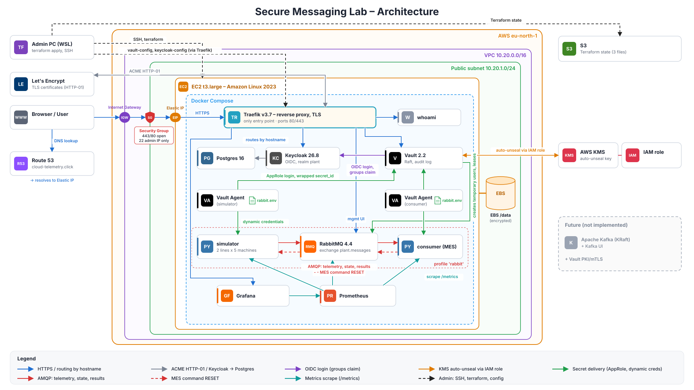
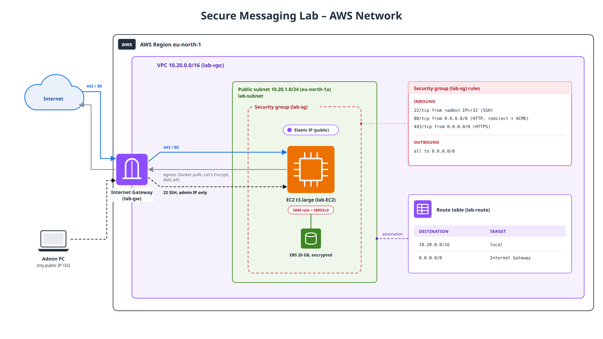
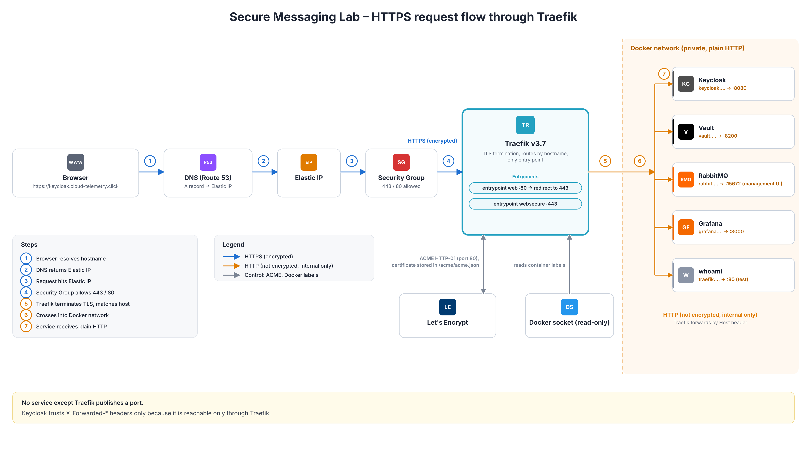
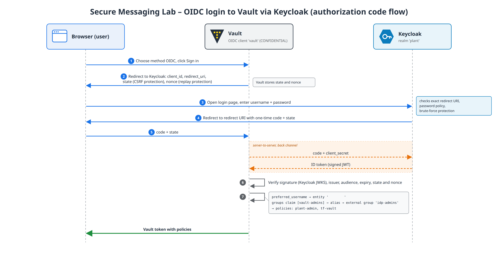
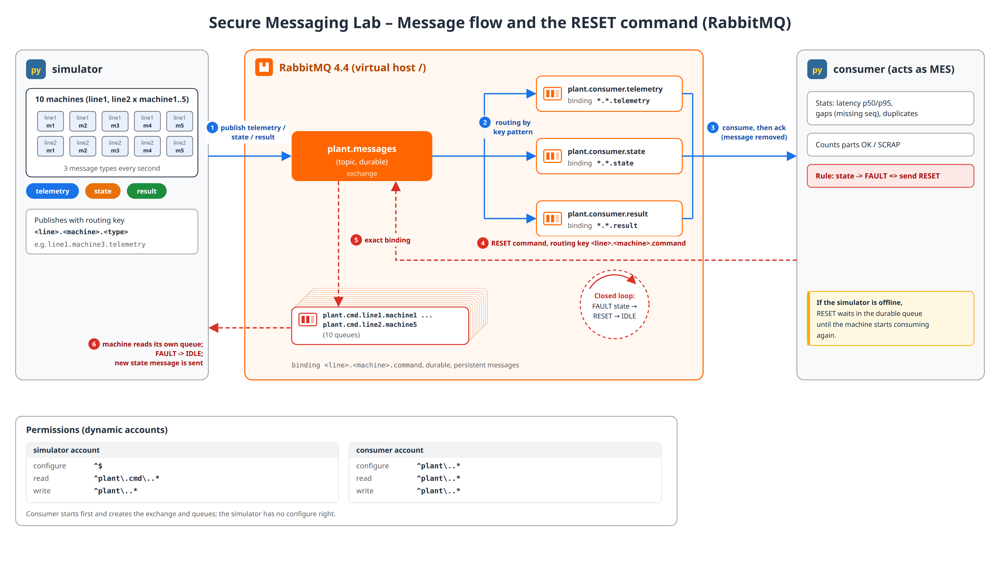
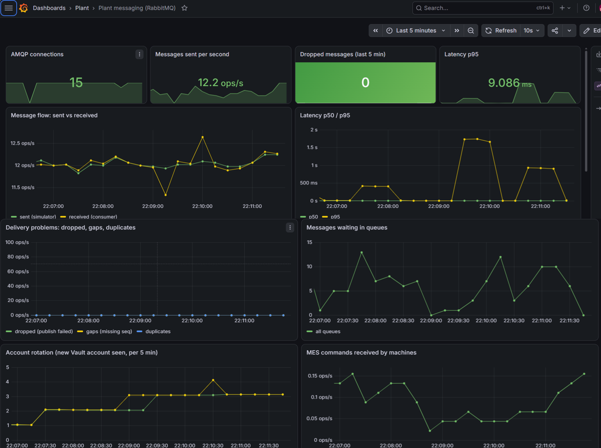

# Secure Messaging Lab

**HashiCorp Vault + Keycloak + RabbitMQ with dynamic credentials, deployed on AWS with Terraform and Docker Compose, monitored with Prometheus and Grafana.**

A learning and project that simulates a small factory (2 production lines × 5 machines) exchanging messages through RabbitMQ. The applications never hold a permanent broker password. Vault creates short-lived RabbitMQ accounts on demand and Vault Agent delivers them to the applications.

For more information, I recommend reading the documentation included in the repository.


---


## Overview

The goal of the project is to learn, and to demonstrate, how to connect several infrastructure and security tools into one working system:

- **Terraform** provisions the AWS infrastructure and configures Vault and Keycloak as code.
- **HashiCorp Vault** stores secrets, authenticates people through Keycloak (OIDC), authenticates applications through AppRole, and issues dynamic RabbitMQ accounts. It uses Raft storage and unseals automatically through AWS KMS.
- **Keycloak** is the identity provider. People log in to Vault with their Keycloak account, and Keycloak groups are mapped to Vault policies.
- **RabbitMQ** carries four message types between simulated machines and a consumer that plays the role of an MES (Manufacturing Execution System).
- **Vault Agent** logs in to Vault on behalf of each application and writes the temporary credentials into a file.
- **Traefik** is the only public entry point. It terminates TLS with Let's Encrypt certificates.
- **Prometheus and Grafana** show message flow, latency, delivery problems, queue backlog and account rotation.

### Simulated factory

| Element | Description |
|---|---|
| Lines | `line1`, `line2` |
| Machines | `machine1` to `machine5` on each line (10 machines in total) |
| Message types | telemetry, state changes, production results, commands from MES to a machine |

---

## Tech Stack

| Category | Technology |
|----------|-----------|
| Infrastructure as Code |  (AWS, Vault and Keycloak providers, S3 backend with state locking) |
| Cloud Provider |  (EC2, EBS, Elastic IP, VPC, IAM, KMS, Route 53, S3) |
| Containerization |   (profiles, Buildx) |
| Reverse Proxy |  (TLS termination, routing by Docker labels) |
| SSL Certificates |  (ACME HTTP-01, built into Traefik) |
| Secrets Management |  (Raft storage, KMS auto-unseal, KV v2, audit log, AppRole, RabbitMQ secrets engine, Vault Agent) |
| Identity Provider |  (OIDC, realm, groups, client mapper) |
| Message Broker |  (topic exchange, durable queues) |
| Database |  (Keycloak backend) |
| Applications |  (`pika`, `prometheus-client`) |
| Monitoring |   (provisioned datasource and dashboard) |
| Operating System |  (EC2 `t3.large`, region `eu-north-1`) |
| Version Control |  |

---

## Project Status and Scope

| Area | Status |
|---|---|
| AWS infrastructure (VPC, EC2, EBS, EIP, KMS, IAM, Route 53) | Implemented |
| Traefik with Let's Encrypt | Implemented |
| Postgres and Keycloak (production mode behind a proxy) | Implemented |
| Vault (Raft, KMS auto-unseal, audit log) | Implemented |
| Vault configuration as code (`vault-config`) | Implemented |
| Keycloak configuration as code (`keycloak-config`) | Implemented |
| Vault OIDC login through Keycloak, root token revoked | Implemented |
| RabbitMQ with Vault dynamic accounts, AppRole, Vault Agent | Implemented |
| Simulator and consumer (Python) with a common broker interface | Implemented |
| Prometheus and Grafana with provisioned dashboard | Implemented |
| Apache Kafka (KRaft) with Kafka UI | **Planned, not implemented** |
| Vault PKI and mTLS for Kafka | **Planned, not implemented** |
| Kafka vs RabbitMQ comparison | **Planned, not implemented** |
| CI/CD pipeline | **Planned, not implemented** |

The original plan also included Apache Kafka and a fair comparison between Kafka and RabbitMQ. While building the core (Vault, Keycloak, dynamic credentials, Vault Agent, monitoring), the main goal of the project, learning a large amount of new technology, was already achieved. Kafka and the comparison are kept as future work.

---

## Architecture

### Overall architecture



All services run as Docker Compose containers on a single EC2 instance. Traefik is the only container that publishes ports (80 and 443). Every other service is reachable only through Traefik or only inside the Docker network.

| Component | Role | Version |
|---|---|---|
| AWS EC2 `t3.large` (Amazon Linux 2023, 8 GB RAM) | Host | `eu-north-1` |
| Traefik | Reverse proxy, TLS termination, Let's Encrypt | v3.7 |
| PostgreSQL | Keycloak database | 16 |
| Keycloak | OIDC identity provider | 26.8 |
| HashiCorp Vault | Secrets, Raft storage, KMS auto-unseal | 2.2 |
| Vault Agent (2 instances) | AppRole login, writes `rabbit.env` | 2.2 |
| RabbitMQ (management image) | Message broker | 4.4 |
| `simulator`, `consumer` | Python 3.13 applications | n/a |
| Prometheus | Metrics collection | v3.16 |
| Grafana | Dashboard | 13.1 |
| whoami | Test service for Traefik | latest |

Services with the Compose profile `rabbit`: RabbitMQ, both Vault Agents, simulator, consumer, Prometheus and Grafana. The profile is also the mechanism intended to keep exactly one broker running when Kafka is added later.

### AWS network



| Element | Value |
|---|---|
| VPC | `10.20.0.0/16` |
| Public subnet | `10.20.1.0/24` in `eu-north-1a` |
| Internet Gateway | attached to the VPC |
| Route table | `0.0.0.0/0` to the Internet Gateway |
| Security group inbound | `22/tcp` from the admin IP (`/32`), `80/tcp` and `443/tcp` from `0.0.0.0/0` |
| Security group outbound | all |
| Public address | Elastic IP |

There is no NAT Gateway, no load balancer, no EKS and no MSK, to keep the cost low.

### DNS

The Route 53 hosted zone already exists and is only read by Terraform. Terraform creates one `A` record per service, all pointing at the Elastic IP:

| Subdomain | Service |
|---|---|
| `traefik.<your-domain>` | whoami test service |
| `keycloak.<your-domain>` | Keycloak |
| `vault.<your-domain>` | Vault |
| `rabbit.<your-domain>` | RabbitMQ management UI |
| `grafana.<your-domain>` | Grafana |
| `kafka.<your-domain>` | Reserved for the future Kafka UI |

### Storage

The instance has an encrypted 20 GB `gp3` root disk and a separate encrypted 20 GB `gp3` data volume mounted on `/data` (XFS, mounted by UUID in `/etc/fstab` with `nofail,nodev,nosuid`).

| Directory | Owner (UID:GID) | Content |
|---|---|---|
| `/data/traefik` | root, mode 700 | `acme.json` with certificates |
| `/data/postgres` | set by the image (UID 999) | Postgres data |
| `/data/vault` | 100:1000 | Vault Raft storage |
| `/data/vault-audit` | 100:1000 | Vault audit log |
| `/data/rabbitmq` | 100:101 | RabbitMQ data |
| `/data/agent-secrets` | 100:1000 | `role_id`, `secret_id`, `rabbit.env` of the simulator agent |
| `/data/agent-secrets-consumer` | 100:1000 | `role_id`, `secret_id`, `rabbit.env` of the consumer agent |
| `/data/prometheus` | 65534:65534 | Prometheus data |
| `/data/grafana` | 472:0 | Grafana data |

The data volume survives replacement of the instance. `terraform destroy` deletes it.

### HTTPS request flow



A browser resolves the subdomain through Route 53, reaches the Elastic IP, passes the security group and arrives at Traefik. Traefik terminates TLS and forwards the request over plain HTTP inside the private Docker network to the container selected by the `Host` header. Containers are discovered through Docker labels. Traefik reads the Docker socket in read-only mode.

---


## Project Structure

```
secure-messaging-lab/
├── main.tf                              # AWS infra, deploy + compose provisioners, DNS
├── variables.tf                         # Input variables (region, instance type, AMI, domain, admin_cidr)
├── output.tf                            # Output values (server_ip)
├── provider.tf                          # AWS provider + S3 backend
├── terraform.tfvars                     # Local only, not in git (admin_cidr)
├── .gitignore
├── docs/
│   ├── documentation_SK.docx            # Full project documentation
│   ├── documentation_EN.docx            # Full project documentation
│   ├── architecture-diagram.png         # Overall architecture
│   ├── aws-network.png                  # VPC, subnet, IGW, security group
│   ├── https-flow.png                   # HTTPS request flow through Traefik
│   ├── oidc-flow.png                    # Vault login via Keycloak
│   ├── dynamic-account-flow.png         # Dynamic RabbitMQ account creation
│   └── message-flow.png                 # Message flow and RESET command
├── docker/
│   ├── docker-compose.yaml              # Service definitions (rabbit profile for broker + apps + monitoring)
│   ├── traefik.yaml                     # Entrypoints, Let's Encrypt resolver, Docker provider
│   ├── vault.hcl                        # Vault server: Raft, KMS auto-unseal, listener
│   ├── vault-agent.hcl                  # Agent for simulator: AppRole + rabbit.env template
│   ├── vault-agent-consumer.hcl         # Agent for consumer: AppRole + rabbit.env template
│   ├── initdb.sh                        # Creates Keycloak role and database in Postgres
│   ├── prometheus.yml                   # Prometheus scrape configuration
│   ├── .env                             # Local only, not in git (passwords)
│   ├── .env.example                     # Template of required variables
│   └── grafana/
│       ├── provisioning/
│       │   ├── datasources/
│       │   │   └── prometheus.yaml      # Auto-provisioned Prometheus datasource
│       │   └── dashboards/
│       │       └── provider.yaml        # Dashboard provider configuration
│       └── dashboards/
│           └── plant.json               # Pre-configured dashboard 
├── apps/                                # Python applications 
│   ├── Dockerfile                       # Python 3.13 slim
│   ├── requirements.txt                 # pika, prometheus-client
│   ├── broker.py                        # Abstract Broker interface
│   ├── rabbit_broker.py                 # RabbitMQ adapter (reads rabbit.env on connect)
│   ├── factory.py                       # Selects broker by BROKER variable (Kafka branch planned)
│   ├── messages.py                      # Machines, topics, JSON encode/decode
│   ├── metrics.py                       # Prometheus metrics HTTP server
│   ├── simulator.py                     # 2 lines x 5 machines, 4 message types
│   └── consumer.py                      # MES role: statistics, RESET on FAULT
├── vault-config/                        # Terraform for Vault (separate state)
│   ├── provider.tf                      # Vault provider + S3 backend
│   ├── main.tf                          # KV v2, policies, audit, OIDC, AppRole, RabbitMQ engine
│   └── variables.tf                     # rabbitmq_password (sensitive)
└── keycloak-config/                     # Terraform for Keycloak (separate state)
    ├── provider.tf                      # Keycloak provider + S3 backend
    └── main.tf                          # Realm plant, groups, OIDC client, mapper
```

### Three Terraform projects, three state files

| Project | State key in the S3 bucket |
|---|---|
| repository root (infrastructure) | `messaging/terraform.tfstate` |
| `vault-config/` | `messaging/vault-config.tfstate` |
| `keycloak-config/` | `messaging/keycloak-config.tfstate` |

`vault-config` and `keycloak-config` are separate projects because their providers connect to running services that the infrastructure project creates. In a single state they would depend on resources that do not exist yet.

---

## How It Works

### Three different logins

The system contains three independent authentications. Keeping them apart is the key to understanding the design.

| # | Who logs in | Where | With what |
|---|---|---|---|
| A | Vault | RabbitMQ management API | account `vault_rabbit_user` (tag `administrator`) and its password |
| B | Vault Agent | Vault | AppRole: `role_id` and `secret_id` |
| C | Application (simulator or consumer) | RabbitMQ (AMQP) | temporary account from `rabbit.env` |

The password of `vault_rabbit_user` is the only long-lived secret in the message path. It is stored inside Vault. Applications never see it and never talk to Vault.

### Human login to Vault through Keycloak (OIDC)



1. The user chooses the OIDC method in the Vault UI.
2. Vault builds a link to Keycloak containing `client_id`, `redirect_uri`, a random `state` (protection against CSRF) and a `nonce` (protection against replay).
3. The user authenticates in Keycloak (realm `plant`). Keycloak checks the exact redirect URI, the password policy and brute-force protection.
4. Keycloak redirects back to the redirect URI with a one-time `code`.
5. Vault exchanges the `code` and its `client_secret` for an ID token on a server-to-server channel.
6. Vault verifies the token signature (JWKS published by Keycloak), the `state` and the `nonce`.
7. The claim `preferred_username` becomes the Vault entity. The claim `groups` (for example `vault-admins`) is matched to the alias of an external group.

The password is seen only by Keycloak. Vault receives only a signed token.

**Group to policy mapping**

| Keycloak group | Vault external group | Policies |
|---|---|---|
| `vault-admins` | `idp-admins` | `plant-admin`, `tf-vault` |
| `plant-readers` | `idp-readers` | `kv-read` |

An alias matches the exact string received in the token. If the string does not match, no error is shown and the user simply receives no policies.

After the OIDC login is verified, the Vault root token is revoked. The emergency path is `vault operator generate-root` with the recovery key.

### Creation of a dynamic RabbitMQ account


1. Vault Agent reads `role_id` and the wrapped `secret_id` from files and logs in with AppRole.
2. Vault returns a token with only one policy (`simulator` or `consumer`), which allows reading exactly one path, for example `rabbitmq/creds/simulator`.
3. Vault Agent reads `rabbitmq/creds/simulator`.
4. Vault logs in to the RabbitMQ management API as `vault_rabbit_user` and creates a user `approle-<uuid>` with the permissions defined by the role.
5. Vault stores a **lease**, a record of when the account must be deleted, and returns username, password and lease id to the agent.
6. Vault Agent renders a template into `/vault/secrets/rabbit.env` (`RABBITMQ_USERNAME`, `RABBITMQ_PASSWORD`, mode `0600`).
7. The application reads the file on every (re)connect and logs in to RabbitMQ with the temporary account.

The directory holding `rabbit.env` is mounted into the application container, not the single file. Vault Agent replaces the file by renaming a new one, and a single-file mount would keep pointing at the old inode.

### Rotation, leases and the periodic token

- Accounts have a lease. In this lab the values are short on purpose: `default_lease_ttl` 60 s and `max_lease_ttl` 120 s, so that rotation is visible. Production values would be hours.
- The agent requests a new account before the old one expires. In the lab a new account appeared roughly every 86 to 95 seconds.
- The old account is deleted by Vault when its lease ends. The application reconnects and the adapter reads the new account from `rabbit.env`.
- The agent token is a **periodic token** (`token_period`). Unlike a token limited by `token_max_ttl`, it has no hard ceiling and is renewed for as long as the agent runs. Without it, the agent would lose its token at the maximum TTL, would have no `secret_id` to log in again and the applications would stop working.

### Response wrapping of the `secret_id`

The `secret_id` is never written in clear text. It is created with `-wrap-ttl=5m`, which returns a single-use wrapping token. Vault Agent unwraps it (`secret_id_response_wrapping_path`) and deletes the file after reading (`remove_secret_id_file_after_reading`).

A new wrapped `secret_id` is needed when:

- a Vault Agent container is restarted
- the EC2 instance is stopped and started
- the agent was down for longer than the token period

If the agent is running and has no token, writing a new wrapped `secret_id` file is enough, the agent picks it up on its own. If the agent already has a token, it must be restarted after the file is written.

### 7.6 Revoking an account

Revoking a lease (`sys/leases/revoke/<lease_id>`) deletes the account in RabbitMQ immediately. This is the correct response to a leaked credential. The application receives `ACCESS_REFUSED` until the agent obtains a new account. During that time the simulator drops messages, which is visible in the dashboard.

### Message flow and the RESET command



- The simulator publishes to the exchange `plant.messages` with the routing key `<line>.<machine>.<type>`, for example `line1.machine3.telemetry`.
- The consumer has three queues bound with the patterns `*.*.telemetry`, `*.*.state` and `*.*.result`. It acknowledges every message after handling it.
- When the consumer sees a state change to `FAULT`, it plays the MES role and publishes a `RESET` command with the routing key `<line>.<machine>.command`.
- Each machine has its own durable queue `plant.cmd.<line>.<machine>`. The simulator reads it and moves the machine back to `IDLE`. A command for an offline machine waits in its queue.

**RabbitMQ topology**

| Object | Name | Notes |
|---|---|---|
| Exchange | `plant.messages` | topic, durable |
| Queues (3) | `plant.consumer.telemetry`, `plant.consumer.state`, `plant.consumer.result` | consumer side |
| Queues (10) | `plant.cmd.line1.machine1` to `plant.cmd.line2.machine5` | one per machine, durable |

**Permissions of the dynamic accounts**

| Role | configure | read | write |
|---|---|---|---|
| `simulator` | `^$` | `^plant\.cmd\..*` | `^plant\..*` |
| `consumer` | `^plant\..*` | `^plant\..*` | `^plant\..*` |

The simulator has no `configure` right, so it cannot create an exchange or a queue. The consumer therefore has to start first and create the topology.

---

## Message Model

All messages are UTF-8 encoded JSON. The broker does not inspect the content. The common fields below are present in telemetry, state and result messages.

| Field | Meaning |
|---|---|
| `run` | Start time of the simulator. Lets the consumer distinguish a restart from a duplicate |
| `line`, `machine`, `type` | Origin and message type |
| `seq` | Sequence number, counted per machine and per type |
| `sent_at` | Send time, used to compute latency |

| Type | Routing key | Extra fields |
|---|---|---|
| telemetry | `line1.machine3.telemetry` | `state`, `temperature_c`, `vibration_mm_s`, `spindle_rpm` |
| state change | `line1.machine3.state` | `from`, `to`, `cause` (`auto`, `fault`, `auto-recover`, `command:RESET`) |
| production result | `line1.machine3.result` | `part_id`, `quality` (`OK` or `SCRAP`), `cycle_time_s` |
| command from MES | `line1.machine3.command` | `command` (`RESET`), `sent_at`, `reason` (no `run` or `seq`, because the consumer sends it) |

**Example: telemetry**

```json
{"run":1794423000,"line":"line1","machine":"machine3","type":"telemetry","seq":4812,"sent_at":1794426123.456,"state":"RUNNING","temperature_c":72.31,"vibration_mm_s":2.514,"spindle_rpm":12043}
```

**Example: state change**

```json
{"run":1794423000,"line":"line1","machine":"machine3","type":"state","seq":17,"sent_at":1794426130.2,"from":"RUNNING","to":"FAULT","cause":"fault"}
```

**Example: production result**

```json
{"run":1794423000,"line":"line1","machine":"machine3","type":"result","seq":61,"sent_at":1794426133.9,"part_id":"line1-machine3-61","quality":"OK","cycle_time_s":4.37}
```

**Example: command**

```json
{"command":"RESET","sent_at":1794426131.1,"reason":"fault"}
```


### Simulator behaviour

| Aspect | Behaviour |
|---|---|
| Telemetry | One message per machine per tick (default 1 s, `TICK_SECONDS`) |
| `IDLE` to `RUNNING` | Random, 10 % per tick |
| `RUNNING` to `FAULT` | Random, 1 % per tick |
| `RUNNING` to `IDLE` | Random, 0.5 % per tick |
| `FAULT` to `IDLE` | Command `RESET` from the consumer, or automatically after 120 s |
| Production result | Only in `RUNNING`, after a cycle of 3 to 6 s; `SCRAP` with a probability of 5 % |

### Python application design

- `broker.py` defines the abstract `Broker` interface: `publish`, `subscribe` (with a `group`), `provision` and `close`. Applications depend only on this interface.
- `rabbit_broker.py` is the RabbitMQ adapter. Publishing and every subscription use separate connections, because `pika.BlockingConnection` is not thread-safe. Credentials are re-read from `rabbit.env` on every connection attempt, so a new Vault-issued account is picked up after a reconnect.
- `factory.py` selects the adapter from the `BROKER` environment variable. A Kafka branch is planned here.
- Topic names carry no prefix in the application. The adapter adds the `plant.` prefix for exchange and queue names.

---

## Monitoring

Prometheus scrapes three targets every 15 seconds. It has no public endpoint and is reachable only inside the Docker network. Grafana is published through Traefik at `grafana.<your-domain>`.

| Job | Target | Source |
|---|---|---|
| `rabbitmq` | `rabbit:15692` | RabbitMQ Prometheus plugin |
| `simulator` | `simulator:8000` | `prometheus_client` |
| `consumer` | `consumer:8001` | `prometheus_client` |

**Application metrics**

| Metric | Type | Meaning |
|---|---|---|
| `sim_messages_sent_total{kind}` | counter | Messages handed to the broker |
| `sim_messages_dropped_total{kind}` | counter | Messages that failed to publish |
| `sim_commands_received_total{command}` | counter | Commands received by machines |
| `cons_messages_received_total{kind}` | counter | Messages received by the consumer |
| `cons_latency_seconds{kind}` | histogram | Time from `sent_at` to receive |
| `cons_gaps_total` | counter | Missing sequence numbers |
| `cons_duplicates_total` | counter | Repeated or reordered sequence numbers |
| `cons_parts_total{quality}` | counter | Finished parts by quality |
| `broker_account_rotations_total` | counter | Connections made with a different account than the previous one |
| `broker_connect_failures_total` | counter | Failed connection attempts |

**Dashboard "Plant messaging (RabbitMQ)"**



| Panel | Purpose |
|---|---|
| AMQP connections | Number of broker connections (around 15 in normal operation) |
| Messages sent per second | Simulator throughput |
| Dropped messages (last 5 min) | Publish failures, should be 0 |
| Latency p95 | Delivery latency |
| Message flow: sent vs received | Both lines should move together |
| Latency p50 / p95 | Latency over time |
| Delivery problems | Dropped, gaps and duplicates |
| Messages waiting in queues | Backlog |
| Account rotation | New Vault account seen, per 5 minutes |
| MES commands received by machines | RESET commands |


The account rotation panel counts, per application, how often a new account name was seen at connection time. With the lab TTLs the line stays around three rotations per five minutes and moves between two and four, because the five-minute window always catches a whole number of rotations.

---


## Security Considerations

| Risk | Impact | Why accepted in the lab | Production approach |
|---|---|---|---|
| AWS root access keys used for Terraform | full account takeover if leaked | test account, MFA enabled, budget alert | IAM Identity Center with short-lived credentials and least privilege |
| Public repository | accidental publication of secrets | strict `.gitignore`, secrets only in ignored files | secret scanning in CI, pre-commit hooks |
| SSH on port 22 | brute force, key theft | restricted to one `/32` address | SSM Session Manager or VPN, no open port |
| Docker socket mounted in Traefik (read-only) | compromise of Traefik means root on the host | single-host lab | Docker socket proxy |
| `client_secret` and the password of `vault_rabbit_user` stored in Terraform state in S3 | anyone with read access to the bucket can read them | private, versioned, encrypted bucket | write-only arguments, restricted bucket policy, customer-managed KMS key, rotation after setup |
| First secret (`secret_id`) delivered by hand | manual step after every start | response wrapping limits exposure to five minutes and one use | orchestrator that generates wrapped secrets, or AWS auth method with the instance IAM role |
| Policy `tf-vault` is almost root | an admin can grant themselves any right | single operator | split duties, dedicated pipeline identity |
| `sudo` capability on `sys/audit` | an admin can disable the audit log | single operator | audit changes only through a pipeline |
| Audit log without rotation; client address shows the proxy | disk growth, weaker forensics | short-lived lab | log rotation, central log store, `x_forwarded_for` on the listener |
| Plain HTTP between Traefik and the services | readable on the Docker network | one host, isolated network | mTLS between components |
| Short lab TTLs | many accounts created and deleted | makes rotation visible | hours instead of seconds |
| `POSTGRES_PASSWORD` in container environment | visible in `docker inspect` | bootstrap secret | Docker secrets or `*_FILE` variables |
| One recovery key share | single person can recover Vault | single operator | five shares, threshold three |
| IMDS hop limit 2 | containers can reach instance metadata | needed so Vault in a container reaches the IAM role credentials | restrict container access to IMDS where possible |

Other measures already in place:

- Root token revoked after OIDC login was verified.
- Vault audit device writes every request (fail-closed: Vault refuses requests when it cannot write the log).
- IMDSv2 is required. The IAM role may use only `kms:Encrypt`, `kms:Decrypt` and `kms:DescribeKey` on one key.
- Keycloak runs in production mode behind a proxy with password policy and brute-force protection. Self-registration is off.
- Only Traefik publishes ports. Postgres, Vault, RabbitMQ AMQP, Prometheus and Keycloak have no `ports:`.
- Each application receives its own account with minimal permissions, and the Vault policy of each agent allows reading exactly one path.

---

## Cost

Prices are approximate and depend on the region and on the date. Verify them in AWS Pricing.

| Item | Approximate cost |
|---|---|
| EC2 `t3.large` | around 0.1 USD per hour while running; nothing while stopped |
| 2 × EBS 20 GB `gp3` | a few USD per month, also while the instance is stopped |
| Elastic IP (public IPv4) | around 3.6 USD per month, also while the instance is stopped |
| KMS key | around 1 USD per month |
| Route 53 hosted zone | around 0.5 USD per month |
| S3 state bucket | cents per month |

Recommendations:

- Stop the instance between work sessions. Destroy the project only when finished or to verify the rebuild.
- Set an AWS Budget with an e-mail alert. It does not stop anything, it only warns.
- After `terraform destroy`, check the region `eu-north-1` for leftovers: instances, volumes, Elastic IPs, snapshots, VPCs. A KMS key stays in the state *Pending deletion* for 7 days. An unassigned Elastic IP is billed like an assigned one.

---
## Future Work

The code is prepared for a second broker: the applications depend only on the `Broker` interface, `factory.py` selects the adapter, the Compose profile mechanism can keep exactly one broker running, and the DNS name `kafka.<your-domain>` is reserved.

Planned:

- Apache Kafka in KRaft mode with Kafka UI, as a Compose profile `kafka`, and a Kafka adapter in `apps/`.
- Vault PKI secrets engine and mTLS for Kafka clients.
- A fair comparison of Kafka and RabbitMQ on the simulated factory: throughput and latency, consumer outage, history replay, broker restart, a command for an offline machine, operational effort. The result is meant to show which broker fits which kind of message and why, not to name a winner.
- Vault telemetry (number of leases), node exporter, alerts and Grafana login through Keycloak.
- CI checks: `terraform fmt -check`, `terraform validate`, Python linting and secret scanning.
- AWS auth method for Vault instead of AppRole, automated delivery of wrapped secrets, dynamic Postgres accounts for Keycloak.

---